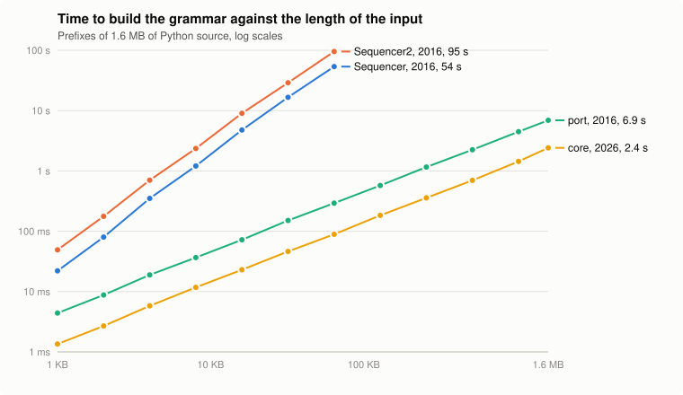
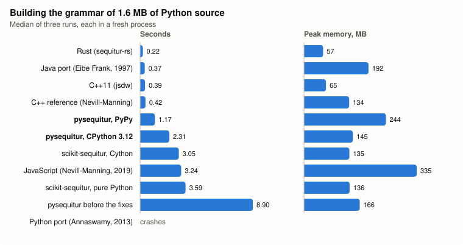

# Performance, correctness and history

Measured in October 2026 on an Apple M4 Pro with CPython 3.12.12, unless noted.
The scripts are in [`benchmarks/`](../benchmarks/) and their raw results in
[`benchmarks/results/`](../benchmarks/results/). See also
[background.md](background.md) for the research on Sequitur and the other
implementations, and [substack/](substack/) for the article distilled from
both.

## Building the grammar against the length of the input

`benchmarks/scaling.py` times each Python implementation in the history of the
library on prefixes of 1.6 MB of Python source, each in a fresh process.

<picture>
  <source media="(prefers-color-scheme: dark)" srcset="images/scaling-dark.svg">
  
</picture>

| Implementation | 1 KB | 4 KB | 16 KB | 64 KB | 256 KB | 1.6 MB |
|---|---:|---:|---:|---:|---:|---:|
| Sequencer, 2016 | 22 ms | 351 ms | 4.8 s | 54 s |  |  |
| Sequencer2, 2016 | 49 ms | 703 ms | 9 s | 95 s |  |  |
| port, 2016 | 4.4 ms | 19 ms | 72 ms | 292 ms | 1.2 s | 6.9 s |
| core, 2026 | 1.4 ms | 5.8 ms | 23 ms | 89 ms | 358 ms | 2.4 s |

- **The core, behind `Sequencer3` since October 2026, is linear**: doubling the
  input doubles the time, at about 650,000 characters a second.
- **The 2016 port is linear too, three to four times slower**, and it builds wrong
  grammars (see [Correctness](#correctness)).
- **`Sequencer` and `Sequencer2` are quadratic** by design: they compare each
  new digram with every rule. They stop in the chart where a run passed 30
  seconds; at that rate the Book of Revelation (46.5 KB) takes about 40 and 70
  seconds.
- **The compiled engine**, which `Sequencer3` uses when `pysequitur_rs` is
  built from `rust/` and installed, is not in the chart: it builds the same
  grammar 19 times faster, the 1.6 MB in 0.14 s (see the
  [comparison](#comparison-with-other-implementations)).

## Comparison with other implementations

`benchmarks/other/compare.py` runs ten other implementations on the same two
inputs, and pysequitur's compiled engine when it is installed, and compares the
grammar each builds with that of Nevill-Manning's C++ reference;
`benchmarks/other/same_grammar.py` checks that pysequitur's grammar, from either
engine, is the same text, rule for rule. `benchmarks/other/fetch.sh` fetches
and builds the others at fixed commits.

<picture>
  <source media="(prefers-color-scheme: dark)" srcset="images/compare-dark.svg">
  
</picture>

| Implementation | Revelation, 46.5 KB | MB | 1.6 MB of source | MB | Rules, symbols on source | Expands back |
|---|---:|---:|---:|---:|---:|---|
| C++ reference (Nevill-Manning) | 0.026 s | 124 | 0.41 s | 134 | 46,218, 255,047 | -, the reference |
| C++11 (jsdw) | 0.008 s | 5 | 0.49 s | 65 | 46,218, 255,005 | yes |
| Rust (sequitur-rs) | 0.006 s | 4 | 0.23 s | 57 | 46,218, 255,005 | yes |
| Java port (Eibe Frank, 1997) | 0.027 s | 82 | 0.31 s | 195 | 43,569, 257,475 | yes |
| JavaScript (Nevill-Manning, 2019) | 0.077 s | 73 | 3.22 s | 335 | 46,313, 255,181 | **no** |
| pysequitur, CPython 3.12 | 0.057 s | 21 | 2.55 s | 144 | same as C++ | yes |
| pysequitur, Rust backend | 0.002 s | 20 | 0.14 s | 118 | same as C++ | yes |
| pysequitur, PyPy | 0.218 s | 67 | 1.23 s | 245 | same as C++ | yes |
| scikit-sequitur, Cython | 0.077 s | 20 | 3.23 s | 131 | same as C++ | yes |
| scikit-sequitur, pure Python | 0.090 s | 20 | 3.76 s | 144 | same as C++ | yes |
| pysequitur before the fixes | 0.239 s | 21 | 9.22 s | 167 | 46,298, 255,483 | **no** |
| Python port (Annaswamy, 2013) | crashes | | crashes | | | |

Times are medians of three runs, for building the grammar only, except the C++
reference, which is timed as a whole process. Memory is the peak resident size
of the process, so it includes each runtime: about 120 MB of the C++ figure is
the table it allocates at start, sized by its `-m 128` option.

- **pysequitur builds the reference's grammar exactly**, on either engine: all
  46,219 rules of the Python source and every rule of the four sample texts.
- **The compiled engine**, behind `Sequencer3` when `pysequitur_rs` is
  installed, builds that grammar 24 times faster than the Python engine on
  Revelation and 19 times on the source, the fastest build here on both, in a
  little less memory.
- **The JavaScript version in the reference repository loses text** on runs of
  three equal symbols, as reported in its
  [issue #3](https://github.com/craignm/sequitur/issues/3), open since 2017.
  pysequitur's 2016 port was translated from it and had the same bug.
- **The Java port** has no handling of such runs and builds different grammars
  that still expand back correctly. **jsdw's C++ and sequitur-rs** agree with
  each other and use 42 fewer symbols than the reference on the source.
- **The Python port by Annaswamy** in the reference repository is Python 2 and
  does not parse as published; patched, it crashes on Revelation.

## Analysis

The analysis layer (`pysequitur.analysis`) builds the grammar and indexes it for
questions. A full `Analysis` with its summary, on the 1.6 MB of source:

| Tokens | Time | Characters a second |
|---|---:|---:|
| characters | 2.46 s | 650,000 |
| words | 1.02 s | 1,570,000 |
| lines | 0.11 s | 14,400,000 |

Revelation by characters takes 0.07 s and a chapter of a novel by words 0.02 s.
Shared passages between documents are found with hashed n-grams of the minimum
length, so comparing documents is linear in their total length too, up to a
cap of 2 million characters.

## What made the core fast

The core (`pysequitur/core.py`) is the algorithm of the C++ reference written
for CPython. Each idea was measured on the 1.6 MB of source against the fixed
2016 port:

| Change | Effect |
|---|---|
| One `__slots__` class for terminals, rule references and guards, no hot-path imports or `isinstance` chains | build 8.7 s → 2.2 s, together with the next row |
| Digram index keyed by tuples of values, rules by identity, instead of formatted strings | also removes collisions between multi-character tokens |
| Rules numbered in one breadth-first pass with dictionaries | extracting the grammar 30 s → 0.04 s |
| Expansion with an explicit stack | no recursion limit on deep grammars |
| CPython 3.14 instead of 3.12 | about 10 % faster |
| PyPy 3.10 | about 2× on large inputs, slower on small ones, twice the memory |
| Cython with typed `cdef` classes | another 2.6×, but needs a compiler to install: not adopted |
| Cython on the untyped code | 15 % slower: rejected |
| Integer digram keys instead of tuples | 15 % slower: rejected |
| The core ported to Rust, used by `Sequencer3` when installed | 19×, the same grammar; optional, so installing pysequitur still needs no compiler |

## Correctness

`benchmarks/correctness.py` checks Sequitur's two promises on every input: the
grammar expands back to the input exactly, no digram occurs twice, and every
rule is used at least twice. On the port as it was from 2016 until the fixes
(commit 71a9298) and after them:

| Input | Inputs | Wrong grammar before | Text lost before | Wrong after |
|---|---:|---:|---:|---:|
| The four sample texts of the library | 4 | 0 | 0 | 0 |
| Python source, in 100 KB pieces | 10 | 10 | 10 | 0 |
| A letter repeated 1 to 100 times | 100 | 95 | 0 | 0 |
| Random strings of a and b | 1,000 | 892 | 812 | 0 |
| Random strings of a, b and c | 1,000 | 823 | 752 | 0 |
| Random strings of eight letters | 1,000 | 367 | 310 | 0 |

Two of the random strings made the root rule's list cyclic, so printing the
grammar never finished. The two bugs, both differences from the C++ reference:

1. When a symbol occurs three times in a row, the two overlapping digrams share
   one index entry. When that one is broken up, the reference indexes the
   digram that starts one symbol earlier (`*lp = left->p`); the port indexed
   `self`. The comment in the reference names the case, `abbbabcbb`, which the
   port turned into `abbbbcbb`.
2. When a match makes a new rule, the reference indexes the rule's body after
   substituting the first occurrence and before the second; the port did it
   earlier, which could leave duplicate digrams and rules.

The test suite (`tests/`) checks the same properties for every implementation
on the sample texts, long runs and seeded random inputs, and the old bugs fail
about 1,900 of its subtests if put back.

## History

| When | What | Revelation, build |
|---|---|---:|
| February 2016 | `Sequencer` and `Sequencer2`, quadratic designs of my own, and `Sequencer3`, a port of mspandit's Python port of Nevill-Manning's JavaScript | 0.24 s for `Sequencer3` |
| June 2025 | An AI coding agent (google-labs-jules) adds `benchmark.py` and marks `Sequencer3` as recommended, from single runs: `Sequencer` 37.8 s, `Sequencer2` 139 s, `Sequencer3` 1.24 s | |
| 2016 to 2025, unnoticed | Python 3.8 removes `int.__str__`, so printing a grammar recurses forever; Python 3.9 reverses the order of comparisons in `list.index` and `in`, so a rule reference equal to 2 matches the token 2 | |
| October 2026 | The two port bugs fixed, test suite of the grammar's promises | 0.19 s |
| October 2026 | `Sequencer3` on the linear-time core, 4× faster, grammar identical to the C++ reference | 0.06 s |
| October 2026 | Analysis layer, MCP server, visualizer | |
| October 2026 | Optional compiled engine in Rust for `Sequencer3`, grammar identical to the Python engine's | 0.002 s |

The June 2025 figure for `Sequencer3` included extracting the grammar, which
then took longer than building it.
