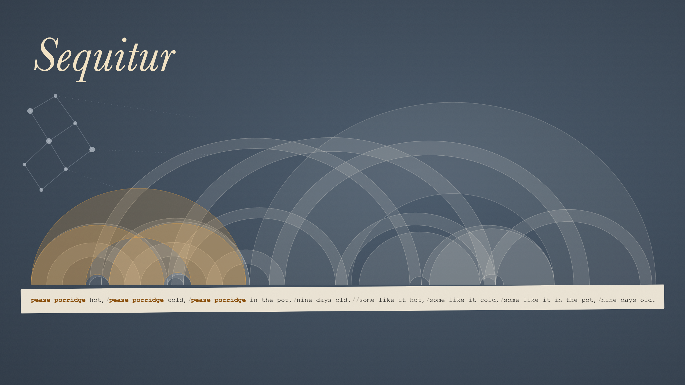
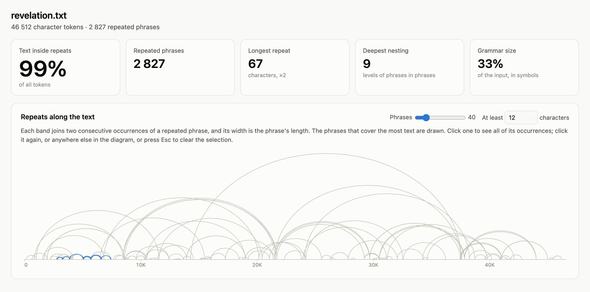
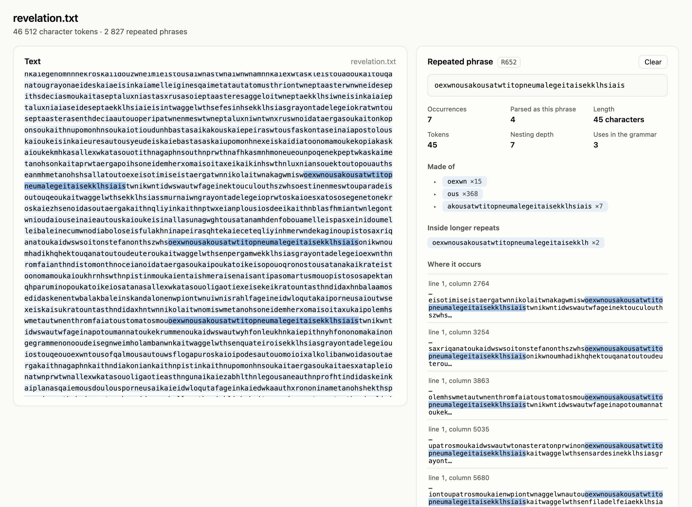
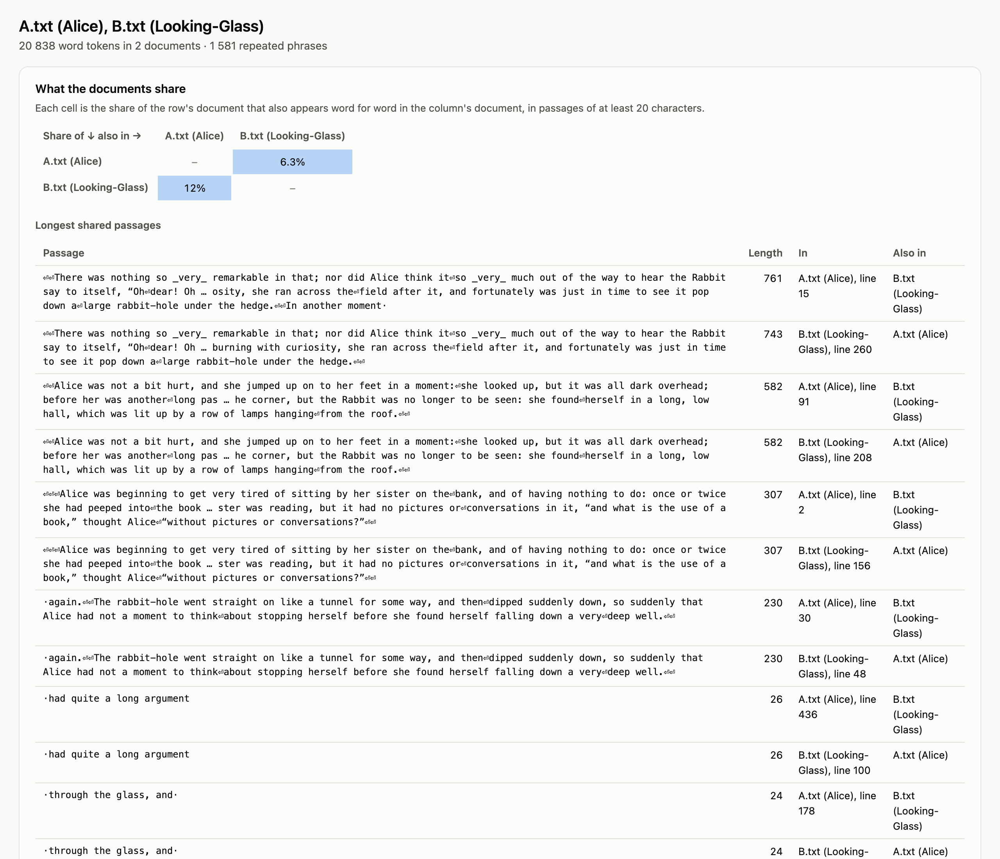
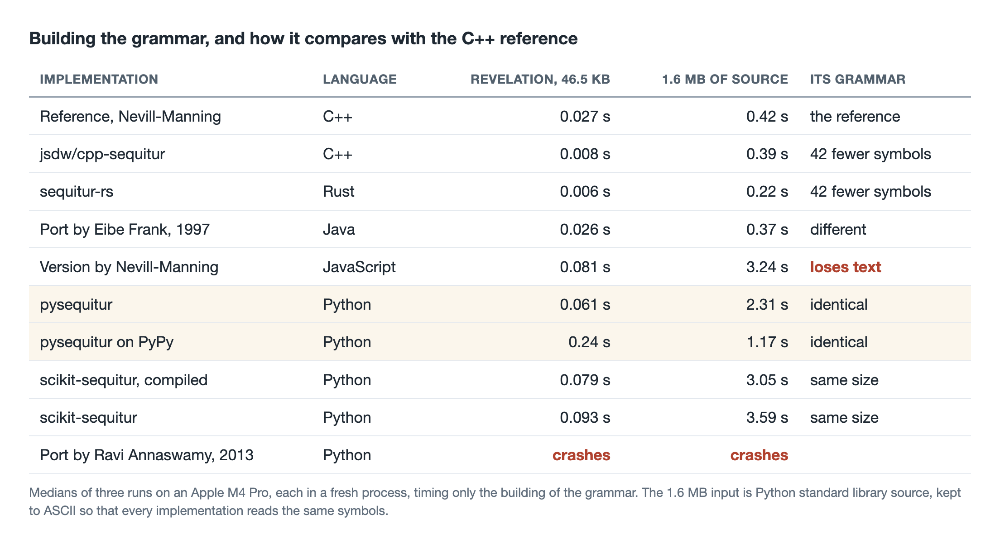
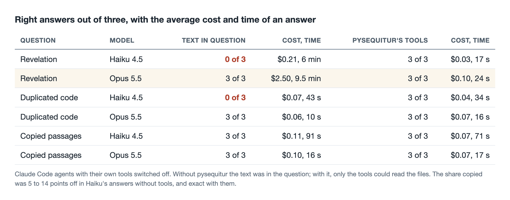

# Giving AI agents an eye for repetition

*A Python library of mine finds every phrase that repeats in a text, with an algorithm from 1997. I compared it with nine other implementations in five languages and gave it to Claude agents.*



*Texts are full of repetition. Songs have refrains, contracts have boilerplate, programs have the same lines in two places, and essays sometimes contain paragraphs from somewhere else. Sequitur, an algorithm from 1997, finds all of it in one pass and arranges it into a hierarchy. This article explains how Sequitur works, what my library pysequitur offers, what makes it fast, how it compares with other implementations, and what it changes for AI agents asked about repetition.*

## What this article is about

Finding repetition exactly is useful. It is how compressors shrink files, how plagiarism checkers work, and how a programmer finds code worth merging. AI agents are now asked such questions too, and they are not good at them. A language model reads text as tokens and can only estimate how often something occurs or exactly where. Asked which long passage repeats most in a 46-kilobyte text, a small model guesses, and a large one counts slowly and expensively, as the field test below shows.

**Sequitur**, published by Craig Nevill-Manning and Ian Witten in 1997, answers such questions exactly. It reads a text once, from start to end, and builds a small grammar of its repetitions. Every phrase that occurs twice becomes a rule, and rules nest inside each other. It does this in time proportional to the length of the text.

[pysequitur](https://github.com/markomanninen/pysequitur) is my Python implementation of Sequitur. It builds exactly the grammar of Nevill-Manning's original C++ program, it is the fastest of the Python implementations I measured, and around the grammar it has an analysis layer, a server that gives AI agents its tools, and a visualizer.

## Sequitur, from 1997 to today's tokenizers

Sequitur keeps two promises about the grammar it builds. No pair of adjacent symbols occurs twice in it, which is called **digram uniqueness**. Every rule is used at least twice, which is called **rule utility**. It reads one symbol at a time. Whenever a pair appears for the second time, it makes a rule for the pair or reuses one, and whenever a rule falls to a single use, it puts the rule's contents back in its place.

Here is the string `abcabdabcabd` being read, at the moments when the grammar changes shape.

```
read so far    grammar
abcab          S → 1 c 1         1 → a b
abcabdabc      S → 1 2 d 1       1 → 2 c   2 → a b
abcabdabcab    S → 1 d 1         1 → 2 c 2   2 → a b
abcabdabcabd   S → 1 1           1 → 2 c 2 d   2 → a b
```

After five letters `ab` has occurred twice and becomes a rule. After nine, `ab c` has occurred twice and becomes a rule too. Two letters later the pair of that rule and `ab` repeats, and the new rule for it leaves the old one with a single use, so the old one is put back in place. At the end the whole string is rule 1 twice, rule 1 is `abcabd`, and rule 2 is `ab`. The rules are numbered afresh each time the grammar is printed. Expanding them gives the string back exactly, so the grammar is also a compressed copy of it.

On real text the rules turn out to be words and phrases. Nevill-Manning and Witten showed that Sequitur [finds words in text without spaces](https://arxiv.org/abs/cs/9709102), splits French *commencement* into *commence* and *ment*, and compresses text about as well as gzip. In Nevill-Manning's [thesis](https://ml.cms.waikato.ac.nz/publications/1996/NevMan-Thesis.pdf) it found two harmonisations of the same 1524 melody among Bach's chorales. James Larus [compressed program traces](https://people.cs.umass.edu/~emery/classes/cmpsci710-spring2003/p259-larus.pdf) with it in 1999 into grammars up to 392 times smaller, Pavel Senin and colleagues [find anomalies in time series](https://csdl.ics.hawaii.edu/techreports/2014/14-05/14-05.pdf) with it, and it has been applied to [malware call traces](https://www.jstage.jst.go.jp/article/ipsjjip/25/0/25_229/_article) and event logs. Theory followed. Finding the smallest grammar of a string is hard, and [Charikar and colleagues](https://scholar.archive.org/work/kkxmd4etnzahze4vi35kkhnwze) bounded how far greedy methods such as Sequitur can be from it.

Sequitur has a famous sibling. **Byte pair encoding**, published by Philip Gage [in 1994](https://jacobfilipp.com/DrDobbs/articles/CUJ/1994/9402/gage/gage.htm), the year of the first Sequitur paper, also replaces repeated pairs of symbols with new symbols. It counts the pairs first and replaces the most frequent one, where Sequitur makes a rule the moment any pair repeats. [Adapted for splitting words](https://aclanthology.org/P16-1162/) in 2016, it became the default way large language models cut text into tokens. The models that struggle to count repetition read text through a cousin of the algorithm that finds it.

More on the history and the uses of Sequitur is in [doc/background.md](https://github.com/markomanninen/pysequitur/blob/master/doc/background.md).

## Using pysequitur

The library has three layers. The grammar itself comes from `Grammar`, which takes characters, words, lines or any other hashable tokens. Questions about a text go to `Analysis`, which maps every repeat back to exact positions in the documents, with line, column and context. For the Greek text of Revelation, transliterated and without spaces, finding the passage of at least 40 letters that covers most of the text takes a few lines.

```python
from pysequitur.analysis import Analysis

a = Analysis.from_files(['revelation.txt'], tokens='char')
top = a.repeats(min_chars=40, limit=1)['repeats'][0]
top['text'], top['occurrences']
# ('oexwnousakousatwtitopneumalegeitaisekklhsiais', 7)
```

That is the refrain of the seven letters to the churches, *he that hath an ear, let him hear what the Spirit saith unto the churches*, and the analysis takes 0.07 seconds. The same object answers where a phrase occurs, which longer phrases contain it, how much of each stretch of a document is repeated material, and which passages several documents share word for word.

For AI agents, `pysequitur-mcp` serves these questions as tools through the [Model Context Protocol](https://modelcontextprotocol.io), or MCP, the standard through which agents call tools. It has nine tools, from `analyze` and `list_repeats` to `find_phrase` and `shared_phrases`, and reads files only under the folders it is given. Its instructions tell the agent which tokens suit which text. Words suit prose, lines suit code and logs, and characters suit text without spaces.

For people, `pysequitur-viz` draws what Sequitur finds. Each band joins two consecutive occurrences of a repeated phrase and is as wide as the phrase is long. Long-distance repeats make wide arcs, and a refrain makes a row of small ones. The idea of drawing repetition as arcs is Martin Wattenberg's, from his artwork [The Shape of Song](https://www.bewitched.com/song.html) (2001) and his [paper on arc diagrams](http://hint.fm/papers/arc-diagrams.pdf).



Selecting a phrase shows its occurrences in the text, the phrases it is made of, and the longer ones it is part of.



For several documents, the page also shows how much of each appears word for word in each other one, and lists the shared passages. Here a chapter of *Through the Looking-Glass*, with four paragraphs of *Alice's Adventures in Wonderland* inserted, is compared with that book.



## What makes it fast

Sequitur is simple to state and fiddly to implement. Every symbol sits in a doubly linked list, every pair of adjacent symbols has an entry in an index, and each new symbol can set off a chain of substitutions. In Python, the cost is in how many objects each step touches and how many method calls it makes. The core of pysequitur keeps both low.

- **One small class for every symbol.** Letters, references to rules and the guards that close each rule are the same class with fixed slots, instead of a class hierarchy with a method call per question.
- **Pairs indexed by plain tuples.** The index of pairs is a dictionary keyed by a tuple of the two symbols' values, with rules compared by identity. Formatting keys as strings is slower and can make two different pairs collide.
- **Linear work everywhere around the algorithm.** Rules are numbered in one pass with a dictionary, which turned the extraction of the grammar of 1.6 MB of source from 30 seconds into 0.04, and expansion runs with an explicit stack instead of recursion.
- **The reference's order of steps.** Where the C++ program does two updates in a particular order, so does pysequitur. The order decides whether duplicate rules can survive.

Together these make pysequitur four times faster than the port of the JavaScript version it replaces. Some ideas did not pay. Compiling the same code with Cython without type declarations made it 15 percent slower, and integer keys for the pairs were 15 percent slower than tuples. Typed Cython made it another 2.6 times faster, but the library would then need a compiler to install, so it stays plain Python. On PyPy, a Python with a just-in-time compiler, it runs about twice as fast on large inputs.

The library is tested against Sequitur's promises rather than against examples. On thousands of random strings and on long runs of a single letter, the tests check that the grammar expands back to the input exactly, that no pair repeats, and that no rule is used once. A separate check prints pysequitur's grammar in the format of the C++ program and compares the two texts.

## How it compares

I ran nine other implementations of Sequitur on the same two inputs, the Revelation text (46.5 KB) and 1.6 MB of Python source, and timed the building of the grammar as the median of three runs. I also compared the grammar each one built with that of Nevill-Manning's C++ reference.



pysequitur builds exactly the grammar of the C++ program, rule for rule and symbol for symbol, down to the last of the 46,219 rules of the Python source. It is the fastest of the Python implementations, though still five and a half times slower than the C++ program and ten times slower than Rust on the large input. On PyPy it halves that gap on the large input and is slower on the small one, where the compiler has no time to warm up.

The grammar column matters more than the times. Nevill-Manning's JavaScript version loses text on the Python source. When the same symbol occurs three times in a row, as in the spaces that indent code, two pairs overlap, and Sequitur indexes only one of them. When that one is broken up, it must index the other, and the JavaScript version indexes the wrong symbol. An [issue](https://github.com/craignm/sequitur/issues/3) reporting wrong grammars from the JavaScript and Java versions has been open in the reference repository since August 2017. pysequitur's earlier port, translated from the JavaScript, had the same mistake until this release. The Java port does not handle runs of equal symbols at all and builds different grammars, though they expand back correctly. The Python port in the reference repository does not run as published, because its license text was pasted in as code, and patched to run, it crashes on Revelation. The C++ and Rust programs by other authors agree with each other and treat runs slightly differently from the reference, which costs nothing in correctness.

## What agents gain

The field test used real agents. I wrote three questions with answers I computed exactly, without Sequitur.

1. **Revelation.** Which passage of at least 40 letters occurs most often in the Greek text? The answer is the refrain, 45 letters, seven times.
2. **Duplicated code.** Which is the longest block of lines that occurs twice in `contextlib.py`, a 27 KB file of Python's standard library? The answer is a block of 25 lines, shared by its synchronous and asynchronous versions.
3. **Copied passages.** Which passages of a chapter of *Through the Looking-Glass* were copied word for word from *Alice's Adventures in Wonderland*, and how much of the chapter is that? I had inserted four paragraphs, 11.2 percent of the text.

[Claude Code](https://www.anthropic.com/claude-code) agents answered each question three times with Anthropic's large model, Claude Opus 5.5, and three times with its small and fast model, Claude Haiku 4.5. They did so in two ways. Either the text was in the question and the agent had no tools, or it was not, and the agent had only pysequitur's tools. The table shows how many of the three answers were right, and the average cost and time per answer.



With the tools, every one of the 18 answers was right. Without them, the small model answered the first two questions wrong all six times. For Revelation its three answers differed. One found the refrain, two letters short, but counted it twice instead of seven times. One named a passage that does not occur in the text and said the text had been cut off, which it had not. The third wrote a Python program, wrote out commands to run it although it had no tools, and reported five occurrences of a passage that occurs once. For the code it found the same 13 lines each time, a block inside the real duplicate of 25.

The large model got everything right on its own, but on Revelation only by counting letters in its reasoning for nine and a half minutes. One answer wrote out 130,000 tokens and cost $3.60, and ended with the words "I checked this by eye". Through the tools, the same model took 24 seconds and ten cents.

The copied passages were found by everyone, because the inserted paragraphs are easy to see once you look for them. How much of the chapter they made up was another matter. Haiku's estimates without tools were 5 to 14 percentage points off, and Opus's up to 2. With the tools, five answers gave 11.2 percent or 11.16, and one rounded it to 11.

The agents used the tools sensibly. All six chose to read Revelation letter by letter, as the server's instructions advise for text without spaces, and needed three or four calls. Two Haiku agents first tried to open the standard library's own copy of `contextlib.py`, outside the folder the server may read. The server refused and named the allowed folder, and both continued with the right file.

Three choices in the tools come from watching agents use them. The tools count occurrences in the text itself, not how often the grammar parses the text into a phrase. Sequitur's greedy parse folds some occurrences into neighbouring rules, so in Revelation it parses only four of the seven refrains as the refrain's rule, and an agent shown that count reports four. Shared passages are listed as exact spans of the documents rather than as rules, because a long passage is split over several rules. And whitespace in a searched phrase matches any whitespace, because a phrase typed on one line may be broken over two in the text. The questions, the agents' transcripts and the scripts are in the [field test folder](https://github.com/markomanninen/pysequitur/tree/master/benchmarks/field_test).

## What I take away from this

1. **Agents should not count by reading.** With a tool, a small model answered questions about repetition exactly. On its own it guessed, and once it pretended to run a program. A large model could do it by reading, at 25 times the cost and 24 times the time.
2. **A tool must answer the question the agent asks, not the one its internals answer.** How often the grammar parses a phrase is not how often it occurs, and the agent cannot know the difference.
3. **Test an algorithm against its own promises, not against examples.** Ordinary prose never triggers the bug in the JavaScript version. A thousand random strings of two letters find it in seconds.
4. **Bugs travel with ports.** One wrong line in a translation of the C++ program has stayed in the reference repository since 2017 and was carried into other ports.
5. **Plain Python is fast enough for this.** At about 650,000 characters a second letter by letter, and 1.5 million word by word, pysequitur analyses a book in well under a second.

## Limits, and how to try it

These are small experiments. The agent test used three questions, three answers per question, model and condition, and only Claude models. The questions were made to have exact answers, and real questions about repetition are messier. The speed measurements come from one laptop, an Apple M4 Pro.

pysequitur is free and open source under the MIT license, on [GitHub](https://github.com/markomanninen/pysequitur). The name is taken on the Python package index by an unrelated project, so it installs from GitHub.

```
pip install "pysequitur[mcp] @ git+https://github.com/markomanninen/pysequitur"
```

The command `pysequitur-mcp --root ~/texts` starts the MCP server for agents, and `pysequitur-viz text.txt` opens the visualizer. The [benchmarks](https://github.com/markomanninen/pysequitur/tree/master/benchmarks) folder has the correctness tests, the comparison with the other implementations, and the agent test, so you can repeat them with your own texts and models, and [doc/performance.md](https://github.com/markomanninen/pysequitur/blob/master/doc/performance.md) has the measurements in full.

## Sources

- C.G. Nevill-Manning and I.H. Witten, [Identifying Hierarchical Structure in Sequences: A linear-time algorithm](https://arxiv.org/abs/cs/9709102), *Journal of Artificial Intelligence Research* 7, 1997.
- C.G. Nevill-Manning, [Inferring Sequential Structure](https://ml.cms.waikato.ac.nz/publications/1996/NevMan-Thesis.pdf), PhD thesis, University of Waikato, 1996.
- M. Charikar et al., [The Smallest Grammar Problem](https://scholar.archive.org/work/kkxmd4etnzahze4vi35kkhnwze), *IEEE Transactions on Information Theory* 51(7), 2005.
- J.R. Larus, [Whole Program Paths](https://people.cs.umass.edu/~emery/classes/cmpsci710-spring2003/p259-larus.pdf), PLDI 1999.
- P. Senin et al., [Time series anomaly discovery with grammar-based compression](https://csdl.ics.hawaii.edu/techreports/2014/14-05/14-05.pdf), EDBT 2015.
- T. Okumura and Y. Oyama, [Grammar Compression of Call Traces in Dynamic Malware Analysis](https://www.jstage.jst.go.jp/article/ipsjjip/25/0/25_229/_article), *Journal of Information Processing* 25, 2017.
- P. Gage, [A New Algorithm for Data Compression](https://jacobfilipp.com/DrDobbs/articles/CUJ/1994/9402/gage/gage.htm), *C Users Journal* 12(2), 1994.
- R. Sennrich, B. Haddow and A. Birch, [Neural Machine Translation of Rare Words with Subword Units](https://aclanthology.org/P16-1162/), ACL 2016.
- M. Wattenberg, [Arc Diagrams: Visualizing Structure in Strings](http://hint.fm/papers/arc-diagrams.pdf), IEEE InfoVis 2002, and [The Shape of Song](https://www.bewitched.com/song.html), 2001.
- The reference implementation and its open [issue #3](https://github.com/craignm/sequitur/issues/3): [github.com/craignm/sequitur](https://github.com/craignm/sequitur).
- Implementations compared: [jsdw/cpp-sequitur](https://github.com/jsdw/cpp-sequitur) at a27a5d1, [sequitur-rs](https://github.com/dylanjwolff/sequitur-rs) at 796d568, [scikit-sequitur](https://pypi.org/project/scikit-sequitur/) 0.4.0, and the C++, Java, JavaScript and Python versions in craignm/sequitur at b6afb6e.
